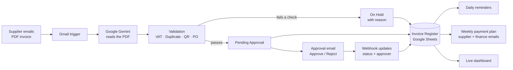

# Invoice & Payment Autopilot

**An AI automation that handles supplier invoices from inbox to payment plan, with no manual data entry.**

A supplier emails a PDF invoice. The system reads it with Google Gemini, checks it against four accounts payable controls, records it in an invoice register, routes it to the right manager for one-click approval, sends reminders, and builds the weekly payment plan.

**Live dashboard:** https://shahwaiz000.github.io/invoice-autopilot/

> All suppliers, invoices and amounts in this project are fictional demo data.

---

## Why I built this

I work in finance in Saudi Arabia. A lot of accounts payable time goes into the same routine: opening invoice emails, typing the figures into a sheet, checking the VAT, making sure the invoice wasn't already paid, chasing managers for approval, and preparing the payment list. This project automates that whole routine. A person only has to click **Approve** or **Reject**.

---

## What it does

| Step | What happens | How |
|---|---|---|
| 1. Capture | Checks the AP inbox every minute for emails with PDF invoices | Gmail trigger |
| 2. AI extraction | Reads the PDF and pulls out invoice number, supplier, VAT number, date, PO number, net, VAT, total and whether a QR code is present | Google Gemini |
| 3. Validation | Runs 4 controls and puts failing invoices **On Hold** with the reason | JavaScript |
| 4. Register | Writes every invoice and its check results to the Invoice Register | Google Sheets |
| 5. Approval | Emails the right approver with **Approve / Reject** buttons, based on amount | Gmail + webhook |
| 6. Reminders | Every morning, re-sends approval emails for invoices waiting 2+ days | Schedule trigger |
| 7. Payment plan | Every Sunday, schedules approved invoices for Thursday, emails each supplier and sends finance a summary | Schedule trigger |
| 8. Dashboard | Live overview of value by status, exceptions, approvals and the next payment run | HTML + Google Sheets |

### The 4 validation controls

| Control | Rule | Why it matters |
|---|---|---|
| VAT check | VAT must be 15% of the net amount (1 SAR tolerance) | Wrong VAT means a wrong invoice and a tax problem |
| Duplicate check | Same invoice number from the same supplier must not exist already | Prevents paying the same invoice twice |
| ZATCA QR check | The invoice must carry the e-invoice QR code | Required by the Saudi tax authority (ZATCA) |
| PO check | The invoice must reference a purchase order | Proves the purchase was authorised |

### Approval matrix

| Invoice total (incl. VAT) | Approver |
|---|---|
| Up to 5,000 SAR | Supervisor |
| 5,001 – 20,000 SAR | Finance Manager |
| Above 20,000 SAR | CFO |

---

## Architecture

The system is 4 connected n8n workflows:

| Workflow | Trigger | Nodes |
|---|---|---|
| **Invoice Email Reader** | New Gmail message with a PDF (every minute) | Gmail Trigger → Gemini Analyze Document → Parse JSON → Read register → Run checks → Append row → Prepare approval → Send approval email |
| **Invoice Decision** | Manager clicks Approve / Reject (webhook) | Webhook → Update row (status, approver, date) → Confirmation page |
| **Approval Reminders** | Daily, 9:00 Riyadh time | Schedule → Read pending invoices → Find invoices waiting 2+ days → Send reminder |
| **Weekly Payment Plan** | Sundays, 8:00 Riyadh time | Schedule → Read approved invoices → Plan payment date → Mark as Scheduled → Email supplier → Build summary → Email finance |

---

## Tech stack

- **n8n**: workflow automation (self-hosted)
- **Google Gemini API**: AI document reading
- **Gmail API**: receiving invoices and sending approval, reminder and payment emails
- **Google Sheets API**: invoice register
- **Webhooks**: one-click approval from email
- **JavaScript**: validation rules, approval routing and payment planning
- **HTML / CSS / JavaScript + GitHub Pages**: live dashboard

---

## Invoice Register columns

`invoice_no` · `supplier` · `amount` · `net_amount` · `vat` · `status` · `po_number` · `vat_check` · `duplicate_check` · `qr_check` · `po_check` · `check_result` · `approver` · `decision_date` · `received_date` · `payment_status` · `scheduled_pay_date`

Statuses: **Pending Approval** → **Approved** / **Rejected**, or **On Hold** if a control fails. Approved invoices move to **Scheduled** in the weekly run.

---

## Test cases

I tested the system with demo invoices built to pass or fail specific controls:

| Demo invoice | Expected result | Result |
|---|---|---|
| Al Noor Office Supplies, 4,600 SAR | Passes all checks | ✅ |
| Desert Tech Solutions, VAT 1,000 instead of 1,200 | VAT check fails → On Hold | ✅ |
| Gulf Print House, no QR, no PO | QR and PO checks fail → On Hold | ✅ |
| Al Noor Office Supplies, same invoice sent again | Duplicate → On Hold | ✅ |
| Sahara Water Supply, 3,450 SAR | Routed to Supervisor → Approved → Scheduled | ✅ |
| Najd Fleet Maintenance, 29,900 SAR | Routed to CFO → Rejected | ✅ |

---

## Current limitations and next steps

- n8n runs locally, so the approval links work on the host machine. Next step: move n8n to a cloud host so it runs 24/7 and approvals work from any phone.
- One PDF per email is processed. Next step: loop over multiple attachments.
- The QR check confirms a QR code is present. Next step: decode the ZATCA QR and compare its VAT and total with the invoice.
- PO check confirms a PO number exists. Next step: 3-way match against a purchase order list.

---

## Author

**Shahwaiz Sulehri**, Finance Executive in Riyadh, Saudi Arabia, building AI and business automation solutions.

- LinkedIn: [linkedin.com/in/shahwaiz-sulehri-360baa302](https://www.linkedin.com/in/shahwaiz-sulehri-360baa302)
- GitHub: [@shahwaiz000](https://github.com/shahwaiz000)
